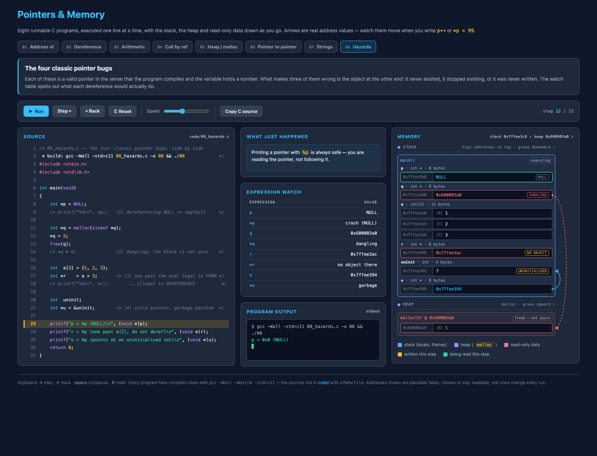

# Pointers & Memory — an interactive C walkthrough

Eight short C programs, executed **one line at a time** in the browser, with the stack, the
heap and the read-only data section drawn as they change. Built for an undergraduate
Operating Systems / Systems Programming course.

**Live demo:** https://mdszn9.github.io/pointer-memory-demo/



## Why this one is different

The arrows are not decoration. Internally a pointer holds a *number*, and the arrow you see
is the result of looking that number up in the memory map. So the diagram behaves the way C
behaves:

- `p++` moves the arrow by `sizeof(int)`, because the number went up by 4.
- `free(p)` leaves the arrow exactly where it was, now pointing into a block drawn in red —
  which is precisely what makes a dangling pointer dangerous.
- `a + 3` produces a pointer with no arrow at all, because there is no object at that address.

Each example also shows an **expression watch** table (`x`, `&x`, `p`, `*p`, …) so students can
connect the C syntax to the picture, and a **console** showing the program's real output.

## The examples

| # | File | What it teaches |
|---|------|-----------------|
| 01 | [`01_addresses.c`](code/01_addresses.c) | `&x`, `*p`, and why `sizeof p` is 8 while `sizeof x` is 4 |
| 02 | [`02_deref.c`](code/02_deref.c) | Writing *through* a pointer; `(*p)++` vs `*p++`; re-pointing |
| 03 | [`03_arithmetic.c`](code/03_arithmetic.c) | Arithmetic counts elements, not bytes; `a[i]` **is** `*(a+i)` |
| 04 | [`04_swap.c`](code/04_swap.c) | Call by value vs. call by reference, with both stack frames drawn |
| 05 | [`05_heap.c`](code/05_heap.c) | `malloc`/`free`, stack-vs-heap, and `arr = NULL` after freeing |
| 06 | [`06_pointer_to_pointer.c`](code/06_pointer_to_pointer.c) | `int **`: count the stars, count the hops |
| 07 | [`07_strings.c`](code/07_strings.c) | The NUL byte; writable `char buf[]` vs. read-only `char *lit` |
| 08 | [`08_hazards.c`](code/08_hazards.c) | NULL deref, dangling pointer, one-past-the-end, uninitialised pointee |

## Controls

| Button / key | Action |
|---|---|
| **Run** / <kbd>space</kbd> | Play the whole program, one line at a time |
| **Step** / <kbd>→</kbd> | Advance a single line |
| **Back** / <kbd>←</kbd> | Go back a line (the trace is replayed from the start, so this is always exact) |
| **Reset** / <kbd>R</kbd> | Return to the state before `main` runs |
| **Speed** | 0.2 s to 2.2 s per line |
| **Copy C source** | Puts the current example on the clipboard |

## Linking to a single step

The URL carries `#<example>/<step>`, so you can send a class straight to one moment:

- `#5/13` — [example 5, the instant after `free(arr)`](https://mdszn9.github.io/pointer-memory-demo/#5/13)
- `#8/12` — [example 8, all four hazards on screen at once](https://mdszn9.github.io/pointer-memory-demo/#8/12)

## The C is real

Every program in [`code/`](code/) compiles clean under `-Wall -Wextra -std=c11` and the
simulated output matches the real program byte for byte (addresses aside — those are plausible
fakes chosen to stay readable).

```bash
cd code
make        # build all eight
make run    # build and run all eight
./05_heap   # or run one
```

Running them under a sanitizer is worth doing in class, especially example 08:

```bash
gcc -Wall -std=c11 -fsanitize=address,undefined -g 08_hazards.c -o 08 && ./08
```

## Running the page locally

No build step and no dependencies:

```bash
python3 -m http.server 8000     # then open http://localhost:8000
```

(`index.html` loads two scripts, so open it over `http://` rather than `file://`.)

## Files

```
index.html     markup + styles
sim.js         the memory model, the eight execution traces, and the renderer
sources.js     generated -- the C sources, embedded for display
code/          the real .c files + a Makefile
tools/         regenerates sources.js from code/
```

After editing any `.c` file, re-run:

```bash
python3 tools/gen_sources.py
```

This keeps the line numbers on the page identical to the files students compile, so a step
that highlights "line 11" really is line 11.

## License

MIT — use freely in your classroom.
